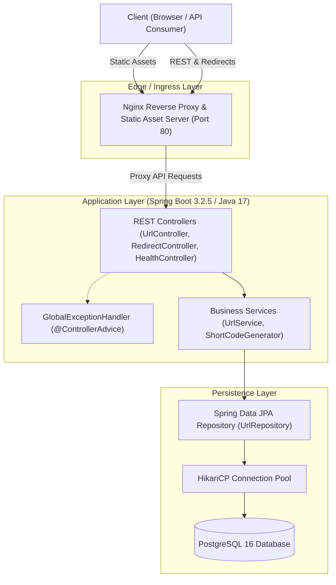
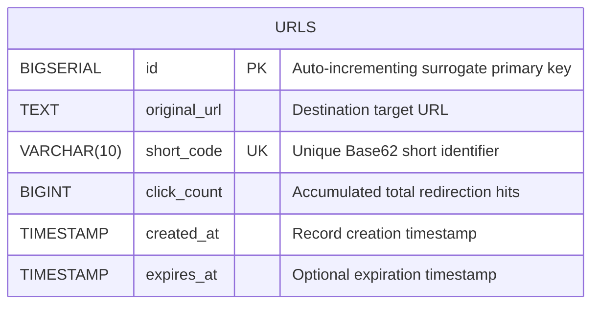
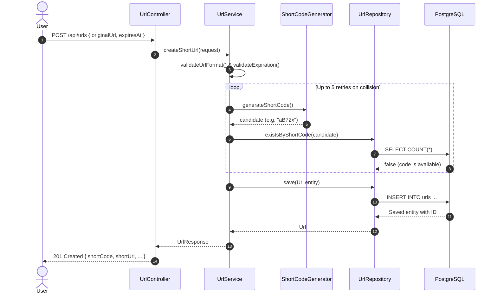
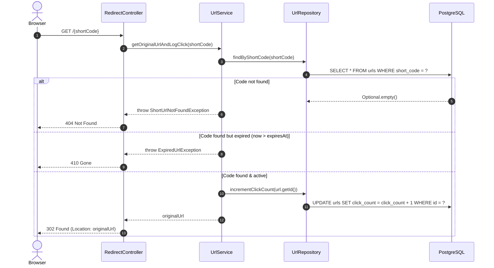

# LinkPulse System Architecture & Technical Design

This document details the architectural blueprints, technical design decisions, data model, and operational mechanisms underpinning the **LinkPulse** URL Shortener & Analytics service.

---

## 1. Architectural Overview

LinkPulse follows a clean, decoupled, layered architecture separating static frontend presentation, application services, and persistent relational data storage.



---

## 2. Layered Responsibilities

| Layer | Component | Primary Responsibility |
| :--- | :--- | :--- |
| **Ingress** | Nginx Reverse Proxy | Serves optimized static assets (HTML/CSS/JS), terminates HTTP connections, proxies `/api/*` and short code redirects to Spring Boot backend. |
| **Web / Controller** | `UrlController`, `RedirectController`, `HealthController` | Validates HTTP payloads, binds path variables, handles CORS preflight checks, returns appropriate HTTP status codes (200, 201, 204, 302, 400, 404, 410, 503). |
| **Exception Handling** | `GlobalExceptionHandler` | Intercepts validation errors and exceptions across all controllers, mapping them to uniform `ErrorResponse` JSON structures without leaking stack traces or internal schema details. |
| **Business Logic** | `UrlService`, `ShortCodeGenerator` | Enforces URL formatting rules (scheme, host), handles expiration checks, resolves Base62 code generation with collision backoff, orchestrates transactional updates. |
| **Data Access** | `UrlRepository`, `Url` entity | Executes queries against PostgreSQL using Spring Data JPA, handles atomic click incrementation via native JPA `@Modifying` queries. |

---

## 3. Data Model & Database Schema

The core persistence entity is mapped to the `urls` table in PostgreSQL.



### Table Definition & Indexing

```sql
CREATE TABLE urls (
    id BIGSERIAL PRIMARY KEY,
    original_url TEXT NOT NULL,
    short_code VARCHAR(10) NOT NULL,
    click_count BIGINT NOT NULL DEFAULT 0,
    created_at TIMESTAMP NOT NULL,
    expires_at TIMESTAMP NULL
);

-- Unique index to guarantee code uniqueness and O(1) B-tree lookup performance
CREATE UNIQUE INDEX idx_urls_short_code ON urls(short_code);
```

---

## 4. Core Workflows

### 4.1 URL Creation & Collision Resolution Flow



### 4.2 Redirection & Atomic Click Counting

To avoid race conditions under concurrent access, click increments do **not** perform an in-memory read-modify-write cycle. Instead, an atomic database UPDATE query is executed:

$$\text{UPDATE urls SET click\_count} = \text{click\_count} + 1 \text{ WHERE id} = :id$$



---

## 5. Security & Reliability

1. **Information Leakage Prevention**: `GlobalExceptionHandler` intercepts generic `Exception.class` and logs the full stack trace server-side while returning a sanitized `{"status": 500, "message": "An unexpected error occurred"}` response to clients.
2. **CORS Security**: Cross-Origin Resource Sharing is configured via `WebConfig` using Spring's `CorsFilter`. `allowCredentials(false)` prevents cross-site credential leakage while allowing open API access for decoupled frontends.
3. **Container Health Probing**: The `/api/health` endpoint verifies both web layer responsiveness and active database connectivity, returning `HTTP 200 (UP)` or `HTTP 503 (DEGRADED)`.
4. **Input Sanitization**: URLs are parsed and verified using `java.net.URI` to ensure valid HTTP/HTTPS schemes and valid host structures before entering the database.

---

## 6. High-Throughput Scaling Roadmap

For production workloads exceeding thousands of requests per second:

- **Redis Cache Layer**: Read-through cache for `short_code -> originalUrl` mappings with TTL matching link expiration to achieve sub-millisecond redirection without hitting PostgreSQL.
- **Asynchronous Click Analytics**: Offload click counter increments from the critical redirection path to an event queue (e.g., Redis Streams or Apache Kafka) with batched database writes.
- **Read/Write DB Splitting**: Direct analytics and listing queries (`GET /api/urls`) to read replicas while routing creations and redirects to the primary PostgreSQL instance.
